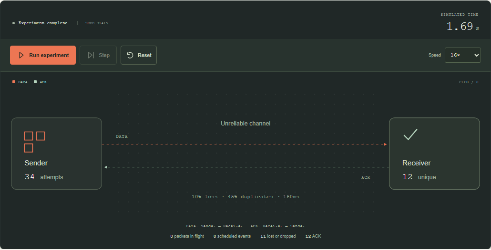

# PACKETLAB

**Reliable delivery, explained.** An interactive laboratory for sending messages through an unreliable simulated channel.

[Open the lab →](https://seoshiro.github.io/packetlab/) · [Verification workflow](https://github.com/seoshiro/packetlab/actions) · [Independent audit](docs/AUDIT.md)

PACKETLAB is a **discrete-event simulation**. It is not a packet analyzer, a real network benchmark, or an RFC-compatible implementation of TCP. Every number in the interface is synthetic and derived from the model below. No sockets are opened by the simulation.



Actual Playwright screenshots from the user's Windows computer: [desktop instrument](docs/screenshots/desktop.png) · [mobile instrument](docs/screenshots/mobile.png).

## Try it in two minutes

1. Start **Send & hope**. Some messages disappear; there is no retry mechanism.
2. Run **Retry storm**. A burst, a small FIFO and premature deadlines create repeated DATA transmissions and queue overflow.
3. Run **Give the link room**. The same burst uses exponential backoff and seeded equal jitter, spreading retries over simulated time. Compare attempts, losses and unique deliveries. This is one reproducible example, not a claim that backoff always wins.
4. Run **Once means once**. Duplicate packets and retries still arrive, but receiver side effects apply once per stable message ID. Turn deduplication off to see why receipt and idempotency are different concerns.

The bundled presets finish with these reproducible outcomes in model v1:

| Preset             | Unique deliveries | Receiver effects | DATA attempts | Retries |
| ------------------ | ----------------: | ---------------: | ------------: | ------: |
| Send & hope        |           11 / 16 |               12 |            16 |       0 |
| Retry storm        |            7 / 16 |               19 |           113 |      97 |
| Give the link room |           16 / 16 |               23 |            69 |      53 |
| Once means once    |           12 / 12 |               12 |            34 |      22 |

These are fixed examples, not statistical estimates. Changing retry or jitter changes the order in which the random stream is consumed, so even a shared seed does **not** imply identical packet-loss realizations across different configurations.

Pause, step one event, change playback speed, and reset. Alter loss, duplication and delay; the experiment restarts when its configuration changes. Export Replay JSON and import it to reproduce the experiment from its beginning. RU and EN are included. On desktop use Space to run/pause, Right Arrow to step and R to reset; shortcuts do not intercept form input.

## Mathematical model

The system contains one sender, one receiver and two independent directional links: DATA travels forward and ACK travels back. A finite set of messages is created at `createdAt(i) = i × sendIntervalMs`, with stable IDs retained by retransmissions.

An event has simulated integer time `t` and monotonically increasing sequence `id`. The scheduler orders lexicographically by `(t, id)`, including ties. A timeout inserted before an ACK at the exact same timestamp therefore fires first and may cause a retry; the tests explicitly cover this boundary. Randomness comes exclusively from a seeded Mulberry32 stream. Rendering, pause and playback speed consume no random values. Reproduction requires the same configuration **and model version**; schema version identifies the configuration format.

Each direction has its own FIFO of capacity `queueCapacity`, including packets waiting for service and the packet being served. Propagating packets are outside that FIFO. A packet that finds a full queue is dropped immediately. Its departure is `max(now, previousDeparture) + serviceMs`.

At departure, an independent Bernoulli trial drops the packet with probability `loss`. A surviving packet gets one additional network copy with probability `duplicate`. The copy does not re-enter the service queue and is not independently lost. Each copy receives independent propagation delay:

```text
delay = max(1, round(delayMs + (2U - 1) × jitterMs)), U ∈ [0, 1)
arrival = departure + delay
```

Propagation can reorder packets even though link service is FIFO. Loss and duplication settings apply equally to DATA and ACK. A received DATA produces an ACK when enabled, including duplicate DATA. The first ACK for a message cancels all future timeout events for that ID. Already transmitted packets remain in flight.

For attempt `a`, the timeout starts when DATA is enqueued, including when the queue rejects it. With backoff enabled, `base = min(timeoutMs × 2^(a-1), 32000)`; otherwise `base = timeoutMs`. Equal jitter uses `max(1, round(base × (0.5 + 0.5U)))`. Without jitter the wait is `base`. Attempts include the original transmission and never exceed `maxAttempts`. A timeout retries only while the sender has no ACK. Retry without ACK is permitted by the model and deliberately exhausts its finite budget; receiver delivery cannot magically inform the sender.

Deduplication stores every received message ID for the duration of this finite run. First receipt increments unique delivery. Each DATA arrival applies a receiver side effect unless that ID was already seen and deduplication is enabled. This demonstrates idempotent handling inside the model, not a universal exactly-once guarantee.

The run completes after its event queue drains, including late DATA and ACK arrivals. With ACK enabled, `failed` means no ACK at completion; a receiver may still have delivered that message. Without ACK, it means no first delivery. An unresolved message at the safety horizon is not silently reported as failed or successful.

### Metrics

| Value             | Definition                                                                             |
| ----------------- | -------------------------------------------------------------------------------------- |
| Delivered         | Number of unique message IDs received                                                  |
| Receiver effects  | Total applications, including repeated applications without dedup                      |
| Retransmissions   | DATA attempts after the first                                                          |
| Dropped           | DATA + ACK packets lost or rejected by FIFO overflow                                   |
| Mean latency      | Mean of `firstDelivery - creation` over delivered messages; absent before any delivery |
| Useful throughput | Unique deliveries / elapsed simulated seconds, in messages/s; zero at t=0              |

Charts show event-time samples of cumulative mean latency and cumulative useful throughput, with deterministic decimation to retain the full time range. They are not instantaneous link bandwidth. No measurements are taken from the user's network.

## Bounds and limitations

- 1–40 messages, 1–12 attempts per message, 1–64 packets per directional queue.
- At most 4,096 pending events and 20,000 processed events; simulated horizon 180 seconds. Reaching a bound produces a visible limited state.
- Trace retains the most recent 512 entries; the interface shows its latest 24 entries and the next seven scheduled events. Charts retain at most 256 samples, with the latest 50 available in each data table. Message outcomes remain available throughout the run.
- Replay schema v1 rejects missing fields, extra fields, unsupported versions, non-finite numbers, coercion and out-of-range values. JSON text is capped at 8,192 characters.
- No TCP streams, congestion window, flow control, routing, variable packet sizes, correlated loss, competing clients, receiver crashes, durable dedup store, distributed clocks or packet capture. `serviceMs` represents fixed packet service, not a measured byte rate.
- Finite retry budgets cannot guarantee eventual delivery. Backoff trades responsiveness for reduced synchronized load. Dedup lasts only for this simulation instance.
- Replay stores configuration and seed, not the current animation cursor. All work stays in memory; no accounts, analytics, backend, paid services or secrets are required.

## Architecture

```text
src/core/             Pure TypeScript state machine, scheduler, PRNG, validation
  simulation.ts       Model transitions and derived metrics
  config.ts           Strict bounded schema and replay import/export
  scenarios.ts        Four reproducible experiments
src/App.tsx           Playback, controls, scenario selection and replay workflow
src/components/       SVG instrument and accessible charts
src/i18n.ts           RU/EN interface copy
tests/                Core regressions and independent browser/model audit
.github/workflows/    Unit → typecheck → lint → build → E2E → Pages
```

The core imports neither React nor DOM APIs. Snapshots copy model state so consumers cannot mutate the simulation. The UI displays an SVG instrument, visible textual state and message outcomes. Reduced motion disables visual movement while preserving simulation controls. Settings use native keyboard-accessible inputs; replay errors are surfaced in the interface. The initial loading screen, empty charts/trace, invalid replay state and application error boundary are real states.

## Run locally

Requires Node.js 22+ and npm.

```sh
npm ci
npm run dev
npm run typecheck
npm run lint
npm test
npm run build
npx playwright install chromium
npm run test:e2e
```

Browser tests use **one worker**. Local browser verification and screenshots are performed on the developer/user's Windows computer in a separate Playwright Chromium, without interacting with other browser sessions. CI runs on GitHub-hosted Ubuntu. The static production build is in `dist/`; Vite's relative base supports GitHub project Pages.

Each build embeds its full Git commit SHA (`GITHUB_SHA` in CI, local `git rev-parse HEAD` otherwise). Check the footer to match the deployed app against the tested commit. Publishing runs only after every verification stage succeeds; live verification is performed separately after deployment.

## License

MIT. Built with TypeScript, React and Vite; tested with Vitest, Playwright and axe-core. All dependencies are locked in `package-lock.json`. No external fonts or image assets.
