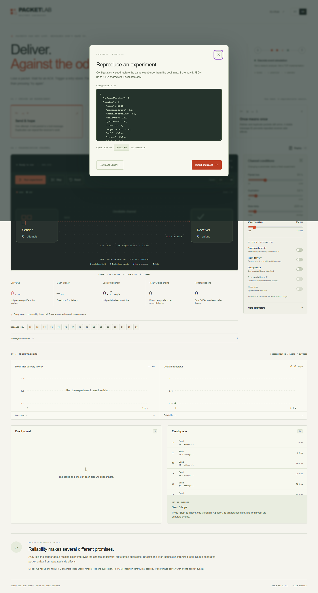

# Independent audit and repair — 23 October 2026

Production: <https://seoshiro.github.io/packetlab/>. Remote baseline independently verified: `b8c0d2c3129d67e7d9274b06a597fa07a4a73661` (`v1.0.0`). A separate clean clone preserved original source. Four new independent reviewers covered algorithm/property oracles, security/data, browser UX, and performance/release. Only the integrator changes source, commits and deploys.

## Reproduced findings and fixes

### PL-01 — P2: a closed replay import still modifies the new dialog

Exact reproduction: open Replay, select a small synthetic file with deferred `File.text()` completion, press Escape, reopen Replay, observe its current exported configuration, then release the old file read. Expected: the new dialog keeps current configuration and stays usable. Actual: obsolete file replaces the current draft; its loading/error completion also belongs to the old session. The timing hook only delays one small real browser file read.

Repair: operation/session generation invalidates async work on close/open and new edits, gates text/error/final loading updates, and releases loading when closing. `tests/e2e/import-audit.spec.ts` retains the reproduction. Independent unchanged browser helper changed FAIL → PASS. [Before screenshot](before-import-race.png), [after](after-import-race.png), [before JSON](import-races-before.json), [after JSON](import-races-after.json).

### PL-02 — P3: config accessor bypasses validated bounds

API reproduction: clone `DEFAULT_CONFIG`, replace enumerable `messageCount` with a getter returning `1` then `-9`, call `validateConfig` or `exportReplay`. Expected: reject executable fields before reading; accepted exports must import. Actual: getter executes twice and returned `messageCount` is `-9`; exported replay fails its own import. Hidden config fields also passed. This is a JavaScript runtime contract defect; JSON cannot encode getters, and no remote exploit is claimed. The bounded reproducer never allocates a large message count.

Repair: require own enumerable data descriptors before validation. `tests/data-boundary.test.ts` verifies zero getter executions, hidden-field rejection and normal round trip. Independent boundary assertions changed FAIL → PASS.

### PL-03 — development dependency advisories

Official npm audit of the baseline lockfile reported three affected package entries (two critical): Vitest 3's `tinypool` and `@vitest/mocker` dependency chain. This is development tooling, not evidence of an exploitable static production site. Sources: [tinypool worker options](https://github.com/tinylibs/tinypool/security/advisories/GHSA-5gmw-xhrv-c9v3), [tinypool run options](https://github.com/tinylibs/tinypool/security/advisories/GHSA-85c8-ppgw-ccpr), [Vitest redirect mock](https://github.com/vitest-dev/vitest/security/advisories/GHSA-82fw-gwwq-j7x9). Updated only Vitest and its resolved dev dependencies to compatible 5.0.5, preserving Vite 7 and Node 22.12+ support. [Before audit](dependency-audit-before.json), [after audit](dependency-audit-after.json): zero known advisories. All model tests, types, lint and build were rerun. No vulnerable-server exploit was attempted.

## Verification and evidence

- [Independent algorithm results](independent-algorithm-results.json): 180 configurations / 9,410 individual event transitions. Separate accounting checks DATA and ACK conservation, event ordering, finite directional queues, retry attempts, backoff/dedup behavior, terminal state, immutable snapshots, replay seed and frame-cadence stability. Additional 64 min/max/toggle boundary cases passed. No model P1/P2 defect was found on valid config inputs.
- 56 unit/model tests passed with updated Vitest, including a many-seed invariant check. Browser suite compares all four presets to model results and covers actual play/pause/step/reset, numeric errors, strict replay rejection, export/import, keyboard and reduced motion; the new interrupted-file regression is included.
- [Final-local browser audit](browser-final-local.json): RU/EN at 320/390/768/1440, narrow dialogs, keyboard focus/Escape, repeated run/reset, export/import, accessible metric semantics and 720 CSS-pixel reflow; no unexpected JS/console/network errors. All 63 cross-project final-local checks and three import-race checks passed. [Mobile capture](after-mobile.png), [desktop](after-desktop.png), [axe desktop](axe-after-initial.json), [axe EN320](axe-after-en-320.json), [axe RU320](axe-after-ru-320.json).
- [Baseline file hashes](source-live-baseline.json) matched live bytes; [CI/Pages baseline](ci-pages-baseline.json) was successful, with no pending release repeated.
- [Measured local performance](performance-baseline.json): bounded worst valid 40-message/12-attempt duplicated workload completed in 15.2–18.1 ms on Node 24 Windows x64. These are local model timings, not network or mobile-device benchmarks; no speed improvement is claimed.

Reproduce: `npm ci`, `npm run typecheck`, `npm run lint`, `npm test`, `npm run build`, `npm run test:e2e`. The independent aggregate [oracle harness](https://github.com/seoshiro/juryflow/blob/main/scripts/audit-independent.mjs) runs on sibling clones and was rerun against the repaired modules. Npm audit sends manifests to the official registry; zero advisories is not complete security assurance.

## Release identity and rollback

The [workflow](https://github.com/seoshiro/packetlab/actions/workflows/release.yml) now generates a source/file-hash manifest, deploys Pages, rebuilds the same `GITHUB_SHA`, compares the live manifest and every asset SHA-256, then runs one-worker production E2E. The [live manifest](https://seoshiro.github.io/packetlab/release-manifest.json) supplies full source identity; the corresponding Actions run/artifacts record the verdict. Pre-commit local preview identifiers are not presented as release proof. Rollback reference is the baseline SHA above; revert audited changes normally and repeat verification/deployment, without force push.

## Actual tool inventory and limits

Used user Codex AGENTS and the installed instruction-only `ecc-windows-engineering` skill with quality/debug, frontend/performance, security/release and Windows references, `21st-ui-review`, full-story verification and React review checklist. No project AGENTS or `.agents/skills` existed. Actual tools: GitHub MCP metadata; existing Git/gh authorization; PowerShell, Node/npm, TypeScript/Vite/Vitest; Playwright and axe on the user's Windows computer; genuine Chrome-extension interactions/screenshots. `21st` CLI absent; ECC runtime/hooks/MCP service not installed or claimed. All resources were free; no account, OAuth, keys, security permission changes or unrelated repositories were touched.

Chromium only; no available Firefox/WebKit or claimed Safari pass. Native browser zoom and human screen-reader tests were not performed; 720 CSS-pixel reflow was checked, and artificial CSS-zoom failures were excluded. Production received ordinary bounded journeys; large property/performance checks ran locally. This remains a discrete-event educational delivery model: no TCP, sockets, real-network measurements or universal reliable-delivery guarantee is claimed.
